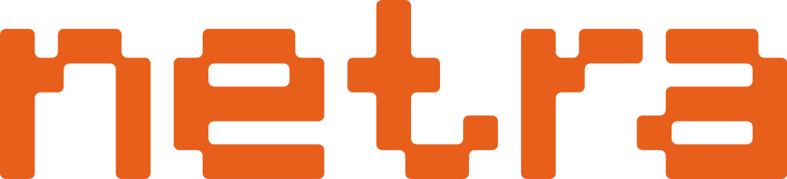
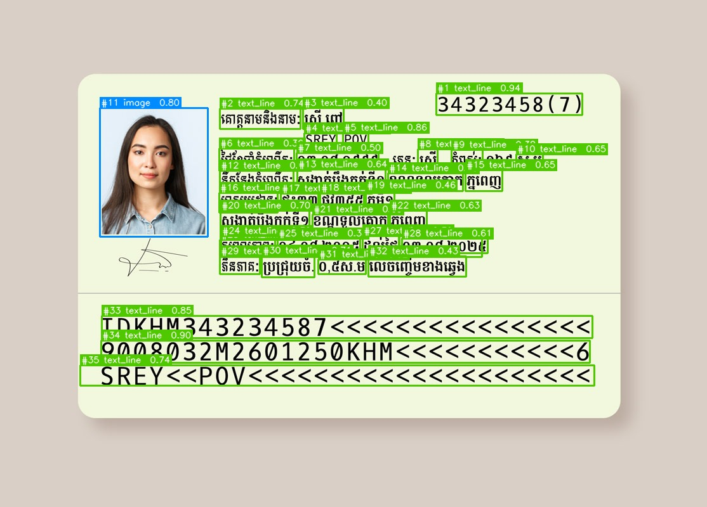
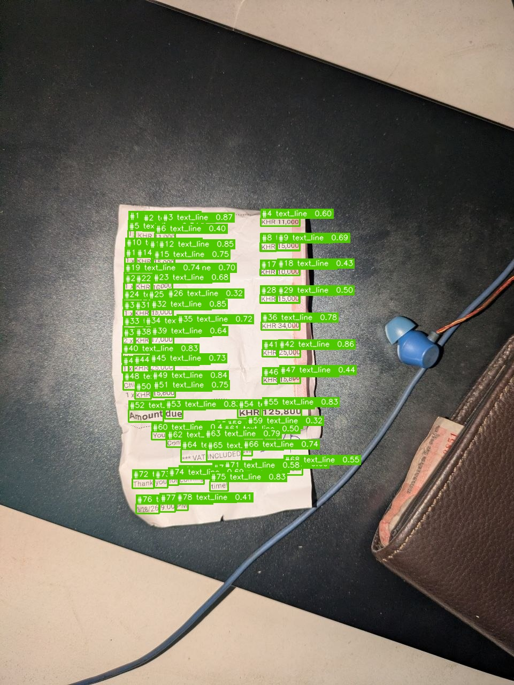
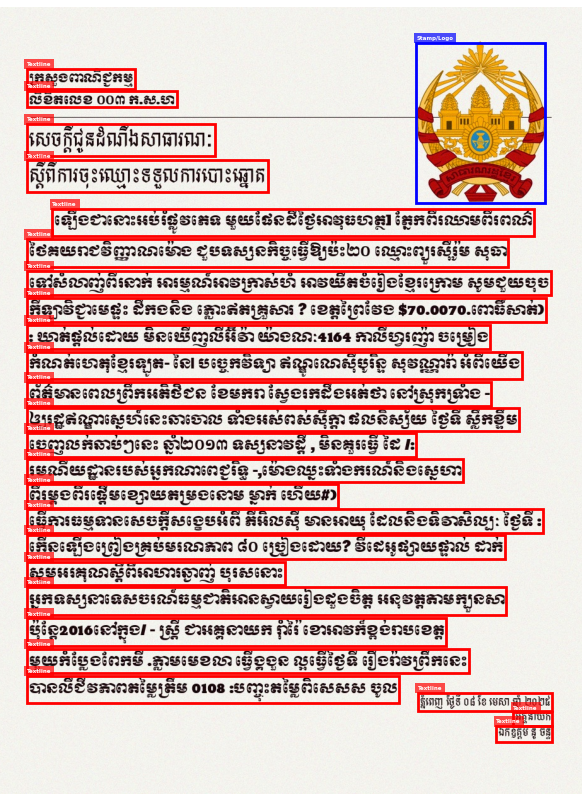
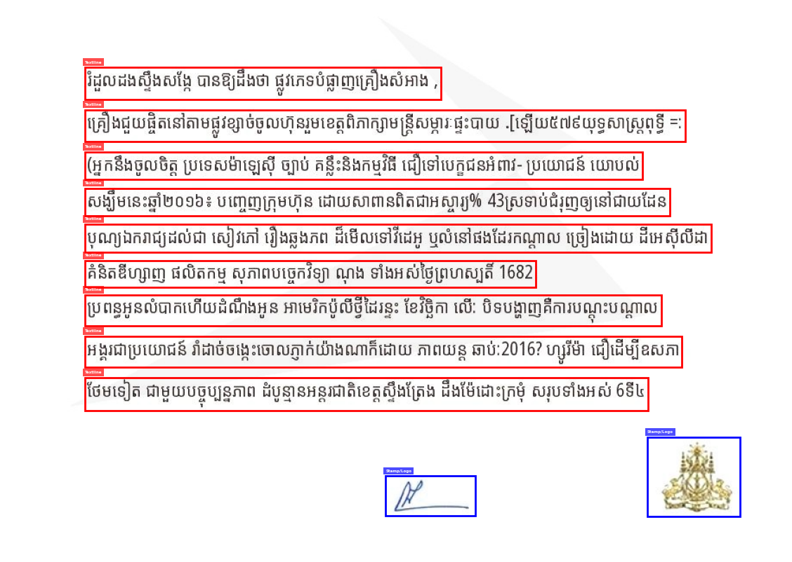
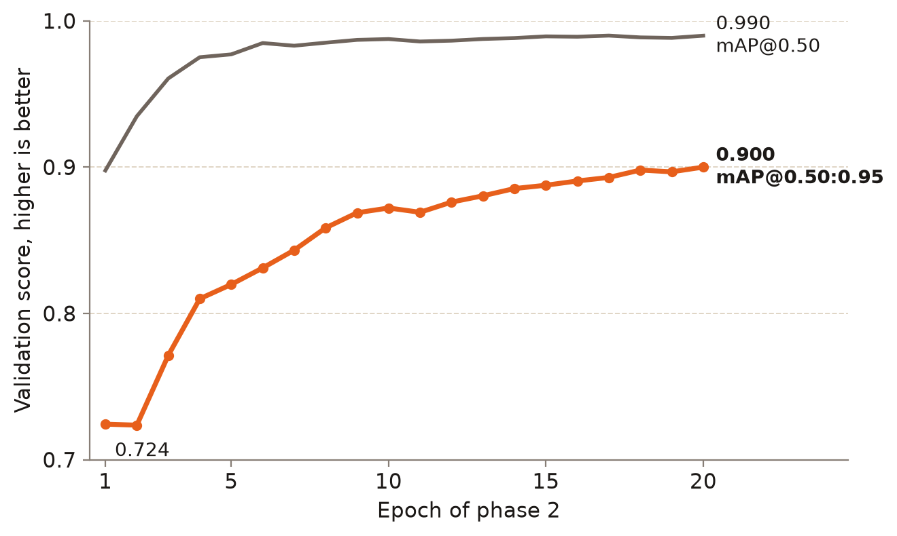

<div align="center">
  
  
</div>

<hr>

<p align="center">
  <a href="https://github.com/netra-ai-lab/Khmer-Text-Detection"><b>GitHub</b></a> |
  <a href="https://github.com/netra-ai-lab/Khmer-Text-Detection/tree/master/src/yolo26s_best"><b>Model Download</b></a> |
  <a href="https://huggingface.co/datasets/Darayut/Textline-Detection-Dataset"><b>Dataset Download</b></a> |
  <a href="https://khmer-text-detection.streamlit.app/"><b>Inference Space</b></a> |
  <a href="https://github.com/netra-ai-lab/Netra-OCR"><b>Netra-OCR</b></a>
</p>

<p align="center">
  
  
  
  
</p>

<h2>
<p align="center">
  Khmer Text Detection: Text Line and Picture Detection for Khmer and English Documents with YOLO26
</p>
</h2>

<p align="center">
  A page in, a box around every text line and every picture out. The line detector behind Netra OCR 1.
</p>

<p align="center">
  
  
</p>

<p align="center">
  <em>The detector's output on a sample ID card and on a phone photo of a printed invoice. Each box is one text line or one picture, with the model's confidence.</em>
</p>

## 1. Abstract

This repository presents Khmer Text Detection, a **9.9M-parameter** YOLO26s detector that finds two things on a page: text lines, in Khmer, Latin script or both, and pictures such as logos, seals, signatures, ID photos and charts. A text recogniser reads one line at a time, so this is the step that comes before it.

1. **Three kinds of data.** Photos of text in the street, document pages, and Khmer documents we generate ourselves, where every box is known exactly.
2. **Two training phases.** The model first learns from the real images, then continues on all three sources together.

On its validation set of 2,764 images the model scores **0.990 mAP@0.50** and **0.900 mAP@0.50:0.95**, with 97.2% precision and 96.2% recall. These are scores on the validation split of its own training data; there is no separate test set yet (see [Limitations](#8-limitations)).

It is the default line detector in [Netra-OCR](https://github.com/netra-ai-lab/Netra-OCR), which runs an ONNX export of this checkpoint.

## 2. Dataset

Khmer Text Detection was trained on 30,658 images from three sources, with 2,764 more held out for validation. The combined set is published as [Darayut/Textline-Detection-Dataset](https://huggingface.co/datasets/Darayut/Textline-Detection-Dataset), with a `source` column that says where each image came from.

### Sources

| Dataset | Type | What it adds |
| :--- | :--- | :--- |
| [DonkeySmall/Yolo-Text-Detection](https://huggingface.co/datasets/DonkeySmall/Yolo-Text-Detection) | Scene text photos | Signs, shopfronts and billboards: blur, glare, odd angles and busy backgrounds |
| [DocLayNet v1.1](https://huggingface.co/datasets/docling-project/DocLayNet-v1.1) | Document pages | Reports, manuals and papers with dense columns, charts and pictures, relabelled to the two classes |
| Synthetic Khmer documents | Generated pages | Khmer letters, notices and memos with stamps, logos and signatures, and exact labels |

| Split | Images |
| :--- | ---: |
| Train | 30,658 |
| Validation | 2,764 |
| **Total** | **33,422** |

The two classes:

| ID | Name | What it is |
| ---: | :--- | :--- |
| 0 | `textline` | One line of text, in any script |
| 1 | `image` | A picture on the page: a logo, seal, signature, photo or chart |

### Synthetic documents

No public dataset has Khmer official documents with a box around every line, so the repo generates them.

1. **Layout.** `src/synthetic_doc_generation/generate_doc_lines.py` lays out a page from the Khmer corpus in `texts/`, in one of 8 templates (letter, announcement, report, memo, two-column and others) and one of 12 page sizes, using the fonts in `fonts/`.
2. **Pictures.** Logos, seals, stamps and signatures from `objects/` are pasted onto the page and labelled as `image`.
3. **Degradation.** The page is blurred, shadowed, folded, given noise and saved as a JPEG, the way a scan or a phone photo would be.
4. **Labels.** The generator places each line itself, so it writes the exact box for each one in YOLO format. No one draws boxes by hand.

<p align="center">
  
  
</p>

<p><em>Figure 1: Two generated Khmer documents with their labels drawn on. Red boxes are text lines; blue boxes are pictures.</em></p>

A first set of 2,300 generated pages, labelled for text lines only, is published on its own as [Darayut/khmer-textline-dataset](https://huggingface.co/datasets/Darayut/khmer-textline-dataset). `src/synthetic_id_generation/` holds a second generator, for synthetic Khmer ID cards.

```bash
pip install -r requirements.txt
python src/synthetic_doc_generation/generate_doc_lines.py --count 200 --seed 42   # writes ./datasets
```

## 3. Model Architecture

**The base model.** [YOLO26s](https://github.com/ultralytics/ultralytics), the small size of Ultralytics' YOLO26, with its output layer retrained for the two classes.

- **One box per object.** YOLO26 is trained with a one-to-one head, so it can give a single box per object without non-maximum suppression. That matters for text: lines sit directly above and below each other, and suppression can delete a real line whose box touches its neighbour's.
- **Small targets.** Its label assignment is built to keep very small boxes in training, such as fine print or a distant sign.
- **Three scales.** Boxes are predicted at strides 8, 16 and 32, so small text and large pictures are found by different grids.

| Feature | Detail |
| :--- | :--- |
| Base model | YOLO26s (Ultralytics) |
| Total parameters | 9,949,412 |
| Input | Long side resized to 640 px |
| Output scales | Strides 8, 16 and 32 |
| Classes | `textline`, `image` |
| Checkpoint | `src/yolo26s_best/best.pt`, 20 MB |

## 4. Training

Training ran in two phases. The first teaches the model what text and pictures look like in real images. The second adds the generated Khmer pages.

| Hyperparameter | Phase 1 | Phase 2 |
| :--- | :--- | :--- |
| Starts from | `yolo26s.pt` (COCO) | Best of phase 1 |
| Data | Scene text, DocLayNet | Scene text, DocLayNet, synthetic Khmer |
| Epochs | 30 | 20 |
| Optimiser | MuSGD | AdamW |
| Batch size | 16 | 16 |
| Image size | 640 | 640 |
| Mosaic | 1.0 | 1.0, off for the last 10 epochs |
| Colour jitter (HSV) | 0.015, 0.7, 0.4 | 0.015, 0.7, 0.4 |
| Shift, rescale | 0.1, 0.5 | 0.1, 0.5 |
| Rotation, shear, perspective, flips | Off | Off |

Rotation, shear, perspective and flips are off because a text line is a thin horizontal box, and a rotated line no longer fits one. The phase 2 settings are in `src/yolo26s_best/args.yaml`.

> **The phase 2 learning rate is not the one in `args.yaml`.** The file asks for `lr0: 5.0e-05`, but `optimizer` was left on `auto`, and in that mode Ultralytics picks the optimiser and its learning rate itself and ignores `lr0`. The log stored in the checkpoint shows what was applied: AdamW, warming up over three epochs to 0.0015, then falling in a straight line to 0.0001.

## 5. Evaluation

Scores are on the validation split (2,764 images), measured by Ultralytics after the last epoch of phase 2.

| Metric | Score |
| :--- | ---: |
| Precision | 0.9715 |
| Recall | 0.9625 |
| mAP@0.50 | 0.9899 |
| **mAP@0.50:0.95** | **0.9000** |

<p align="center">
  
</p>

<p><em>Figure 2: Validation scores after each epoch of phase 2. The model finds almost every box early (mAP@0.50, grey); what keeps improving is how tightly the boxes fit (mAP@0.50:0.95, orange). Drawn by <code>assets/make_figures.py</code> from the log stored in the checkpoint.</em></p>

- **Scoring.** mAP@0.50 counts a box as right when it overlaps the true box by at least half. mAP@0.50:0.95 averages over stricter overlaps up to 95%, so it rewards tight boxes. For OCR the strict score matters more: a box that clips the top of a line cuts off Khmer vowel signs.
- **What the validation set holds.** 2,518 scene photos and 246 synthetic pages, and no DocLayNet pages.

## 6. Install

```bash
git clone https://github.com/netra-ai-lab/Khmer-Text-Detection
cd Khmer-Text-Detection
pip install ultralytics pillow opencv-python-headless
```

| For | Also install |
| --- | --- |
| The REST API | `fastapi uvicorn python-multipart` |
| The web app | `streamlit` |
| Generating data and training | `pip install -r requirements.txt` |

The weights are in the repo (`src/yolo26s_best/best.pt`, 20 MB), so nothing is downloaded on first run. The CPU is enough, and CUDA is used when available.

## 7. Usage

**Python.** Create the analyzer once and reuse it.

```python
from PIL import Image
from src.core import DocumentAnalyzer

analyzer = DocumentAnalyzer()
result = analyzer.predict(Image.open("page.jpg"), conf_threshold=0.45)

for box in result["detections"]:
    print(box["label"], box["confidence"], box["bbox"])   # bbox is [x1, y1, x2, y2] in pixels
```

**Command line.** Writes the page with its boxes drawn on, a JSON file of the boxes, and a crop of every picture.

```bash
python src/cli.py --image page.jpg --model src/yolo26s_best/best.pt --output results/
python src/cli.py --image page.jpg --model src/yolo26s_best/best.pt --conf 0.25 --output results/   # finds more, lets in more mistakes
```

```json
{
    "filename": "test_doc.jpg",
    "confidence_threshold": 0.45,
    "total_objects": 31,
    "detections": [
        {
            "class_id": 0,
            "label": "textline",
            "confidence": 0.9241346716880798,
            "bbox": [202.84, 42.06, 337.17, 63.55]
        }
    ]
}
```

**Web app.** Drop in an image, move the confidence slider, see the boxes. Also hosted as the [demo](https://khmer-text-detection.streamlit.app/).

```bash
streamlit run src/app.py
```

**REST API.** `POST /predict` takes an image file and an optional `conf`, and returns the same JSON as the command line. Run it from `src/`; the interactive docs are at `http://localhost:8000/docs`.

```bash
cd src
uvicorn api:app --host 0.0.0.0 --port 8000
curl -F "file=@../page.jpg" -F "conf=0.45" http://localhost:8000/predict
```

**In Netra-OCR.** To go from a page to text, use [Netra-OCR](https://github.com/netra-ai-lab/Netra-OCR), which runs this detector and then reads each line:

```python
from netra_ocr import KhmerOCRPipeline

pipeline = KhmerOCRPipeline(detector="yolo", decoder="blockwise")
```

**Training.** `kaggle_train_yolo11.ipynb` is the notebook from the first, single-class experiment on the synthetic set. The two-phase run that produced the released checkpoint is described in [Training](#4-training); its script is not in this repo.

## 8. Limitations

- **One validation set.** Every score comes from the validation split of the model's own training data, which is mostly scene photos. There is no separate test set and no comparison with another detector.
- **Real Khmer documents are unmeasured.** The Khmer documents in training are generated. How well the model does on real scans has not been scored.
- **Upright boxes.** Boxes are not rotated, and rotation was off in training. On a page photographed at an angle, a box takes in parts of the lines above and below.
- **Imperfect labels.** The scene-text labels are semi-automatic and miss some text, so the model can learn to miss it too.
- **Lines only.** The model does not group lines into paragraphs or give a reading order. Netra-OCR uses a separate layout model for that.

## 9. Licensing

This project's code is released under the Apache License 2.0 (see [LICENSE](LICENSE)).
- **Weights:** AGPL-3.0, because they were trained with [Ultralytics YOLO](https://github.com/ultralytics/ultralytics). Read that licence before you ship the weights in a product or run a modified version as a service.
- **Training data:** the combined set is CC BY 4.0 and the synthetic set is MIT, per their dataset cards. DonkeySmall is MIT. DocLayNet has its own licence terms; see its dataset card.
- **Fonts and images:** the files in `fonts/`, `objects/` and `backgrounds/` are there for the generator and keep their own licences. <!-- TODO: list the licence of each font family and image source. -->

## References

1. **Ultralytics YOLO26**  
   *Glenn Jocher, Jing Qiu.*  
   Software, version 26.0.0, 2026. AGPL-3.0.  
   [github.com/ultralytics/ultralytics](https://github.com/ultralytics/ultralytics)

2. **DocLayNet: A Large Human-Annotated Dataset for Document-Layout Analysis**  
   *Birgit Pfitzmann, Christoph Auer, Michele Dolfi, Ahmed S. Nassar, Peter Staar.*  
   KDD 2022.  
   [arXiv:2206.01062](https://arxiv.org/abs/2206.01062)
